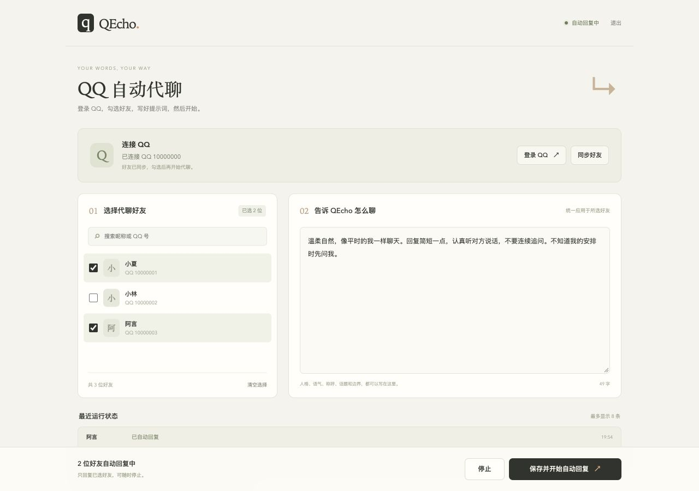

# QEcho · 回声

**登录 QQ，勾选好友，写好提示词，开始自动回复。**

QEcho 是一个本地运行的 QQ 代聊 Agent。你决定回复哪些好友，并用一份提示词控制人格、语气和聊天规则。界面只保留好友选择、提示词和开始/停止按钮，模型与 QQ 连接参数收在折叠设置中。



截图使用本地模拟登录、模型与桥接验收，不是真实 QQ 对话。

## 本地部署

采用 Python 3.12 + uv 源码运行。Windows / Linux 的依赖安装和自动化测试已通过 CI，macOS 已完成本地验收，具体范围见[验证记录](docs/validation.md)。QQ 登录由外置 NapCat 提供，按其支持的平台安装；一个 QEcho 数据目录对应一个 QQ 账号。

### 1. 安装 Git 和 uv

安装 [Git](https://git-scm.com/downloads)，再按 [uv 官方说明](https://docs.astral.sh/uv/getting-started/installation/)安装 uv。

Windows PowerShell：

```powershell
winget install --id=astral-sh.uv -e
```

macOS / Linux：

```sh
curl -LsSf https://astral.sh/uv/install.sh | sh
```

重新打开终端，确认 `git --version` 和 `uv --version` 可用。Python 由下一步的 uv 命令管理，前端无需 Node.js 构建。

### 2. 下载项目、安装 Python 和依赖

```sh
git clone https://github.com/xuhuilun/QEcho.git
cd QEcho
uv python install 3.12
```

**先下载并安装项目所需的 Python 依赖：**

```sh
uv sync --locked
```

该命令会创建项目的 `.venv`，按 `uv.lock` 安装 FastAPI、Uvicorn、HTTPX、间接依赖及 QEcho 启动命令。当前默认同时安装开发检查工具；已有下载缓存会复用。无需逐个安装包或手动激活虚拟环境。

检查安装结果：

```sh
uv run --no-sync python --version
uv run --no-sync python -c "import fastapi, httpx, uvicorn, qecho; print('Python dependencies ready')"
```

应显示 Python `3.12.x` 和 `Python dependencies ready`，再执行下一步。首次下载 Python 和依赖需要可用网络。

### 3. 启动并进入页面

在项目目录执行：

```sh
uv run qecho
```

看到 `Application startup complete` 后，保持终端运行，打开 <http://127.0.0.1:8765>。健康检查地址 <http://127.0.0.1:8765/healthz> 返回 `{"status":"ok"}`。

另开终端进入同一项目目录，读取管理令牌并填入登录页。

Windows PowerShell：

```powershell
Get-Content .data/admin-token
```

macOS / Linux：

```sh
cat .data/admin-token
```

`.data/` 保存数据库、令牌、提示词和聊天记录，默认已被 Git 忽略。管理令牌登录状态只保存在当前浏览器会话中。

### 4. 首次连接模型与 QQ

展开页面底部的“连接设置”，填写模型模式“真实模型”、服务商的 API 根地址、模型名称与 API Key。QEcho 在根地址后追加 `/chat/completions`，读取 `choices[0].message.content`。模型 API Key 保存后不回显；无需鉴权的自部署模型可留空。演练模型不能用于开始真实自动回复。

按 [NapCat 官方说明](https://napneko.github.io/guide/napcat)安装并启动桥接。QEcho 与 NapCat 在同一台电脑、同一网络环境时，配置：

| 位置 | 填写内容 |
| --- | --- |
| NapCat HTTP 服务端 | 开启服务，例如 `127.0.0.1:3000`，设置访问 token |
| QEcho → QQ 连接设置 | 服务地址 `http://127.0.0.1:3000` 和上述服务端 token |
| QEcho → QQ 登录页地址 | 默认 `http://127.0.0.1:6099/webui/qq_login`，以 NapCat 实际地址为准 |
| NapCat HTTP 客户端 | 上报 URL `http://127.0.0.1:8765/webhooks/onebot`，消息格式选数组，开启 `reportSelfMessage`，token 填 QEcho 事件令牌 |

展开“QQ 连接设置”可查看、复制上报地址和事件令牌。事件令牌与 NapCat HTTP 服务端 token 用途不同。模型和连接配置保存后会暂停代聊，准备好后再开始。

这些是首次部署的连接配置。QEcho 不接管 QQ 协议，也不会仅因打开登录页就自动创建 NapCat 的 HTTP 连接。完整配置及异机/容器地址说明见 [QQ 接入说明](docs/qq-connection.md)。

## 开始代聊

1. 点击 **登录 QQ**，打开 NapCat 登录页。页面可能先要求 NapCat WebUI 认证，再选择扫码登录，并在手机确认。
2. 返回 QEcho，登录成功后自动读取 QQ 账号和好友；必要时点击 **同步好友**。无需手填本人 QQ 号。
3. 搜索并勾选需要代聊的好友，在右侧写一份统一 Agent 提示词，例如：

```text
像平时的我一样聊天，语气温柔自然，回复简短。
认真回应对方提到的事情，不要连续追问。
可以聊音乐、电影和日常，不知道我的经历或安排时不要编造。
```

4. 点击 **保存并开始自动回复**。只对选中好友的文本私聊自动回复，未选择的好友和群聊不参与。页面显示运行状态与最多 8 条最近回复状态。

修改选择或提示词后，需再次点击“保存并开始自动回复”一起生效；未应用的修改会有提示。需要立即暂停时，点击始终可用的 **停止**。本人主动回复可接管单个好友，再次明确开始可恢复所选好友。

开始时会重新核对实际 QQ 账号、好友范围和配置版本，失败保持停止。已有真实聊天历史时检测到换号，会暂停并要求新账号使用独立数据目录。已开始的发送请求可能仍会送达，停止不等于撤回；发送结果未知时系统不自动重试。

## 更换端口、备份与升级

默认配置无需 `.env`。如需更换端口，先按 `Ctrl+C` 停止服务，再复制配置并编辑 `QECHO_PORT`：

```sh
cp .env.example .env
uv run --env-file .env qecho
```

Windows PowerShell 复制文件可用 `Copy-Item .env.example .env`。例如改用 8766 端口后，浏览器和 NapCat 上报 URL 都同步改成 8766。普通 `uv run qecho` 不自动加载 `.env`；恢复服务时继续使用与你的配置一致的启动命令。

升级前在页面停止自动回复，再在运行终端按 `Ctrl+C` 停止服务，将整个 `.data/` 复制到仓库外的新备份目录。随后更新代码、重新安装锁定依赖并启动：

```sh
git pull --ff-only
uv sync --locked
uv run qecho
```

使用 `.env` 时，最后一行替换为 `uv run --env-file .env qecho`。数据目录含密钥和聊天记录，备份需妥善保管。数据库未做静态加密；POSIX 文件模式限制和 Windows 继承的 ACL 行为见[部署与数据管理](docs/deployment.md)。

## 常见问题

| 现象 | 检查方式 |
| --- | --- |
| `uv` 命令不存在 | 安装后重新打开终端，按安装提示检查 PATH |
| Python / 依赖安装失败 | 检查网络后重试 `uv python install 3.12` / `uv sync --locked`，保留完整安装报错 |
| 页面打不开 | 保持服务终端运行，确认启动成功且端口正确 |
| 令牌文件不存在或无效 | 先启动服务，在项目目录读取；自定义数据目录或环境令牌时以实际配置为准 |
| 数据目录正在使用 | 停止同目录已有实例；同一个数据目录只允许一个进程 |
| 登录页打不开 | 先启动 NapCat，检查折叠设置中的登录页地址和实际 WebUI 端口 |
| 登录后没有好友 | 检查 OneBot HTTP 服务是否启用、地址/token 是否正确，然后同步好友 |
| 开始时报配置变化 | 其他操作或人工接管发生在启动期间；查看当前状态，再明确开始 |
| 好友来信不回复 | 检查运行开关、选中范围、真人接管状态以及最近错误；只支持好友文本私聊 |
| AI 请求失败 | 检查模型地址、名称、密钥和服务账户状态 |

## 文档与开发

- [极简流程设计](docs/simple-automation-design.md)
- [实施计划](docs/simple-automation-plan.md)
- [QQ 接入](docs/qq-connection.md)
- [部署与数据管理](docs/deployment.md)
- [API 说明](docs/api.md)
- [验证记录与限制](docs/validation.md)

```sh
uv run pytest
uv run ruff check .
uv run ruff format --check qecho tests
```

原有会话 API 和联系人数据保留兼容；新的统一提示词模式不叠加旧联系人隐藏的人格字段。真实模型人格效果、QQ 登录与真实好友收发仍需用户环境验收。

[Dockerfile](Dockerfile) 与 [compose.yaml](compose.yaml) 保留为可选配置，尚未实际验收容器运行。
