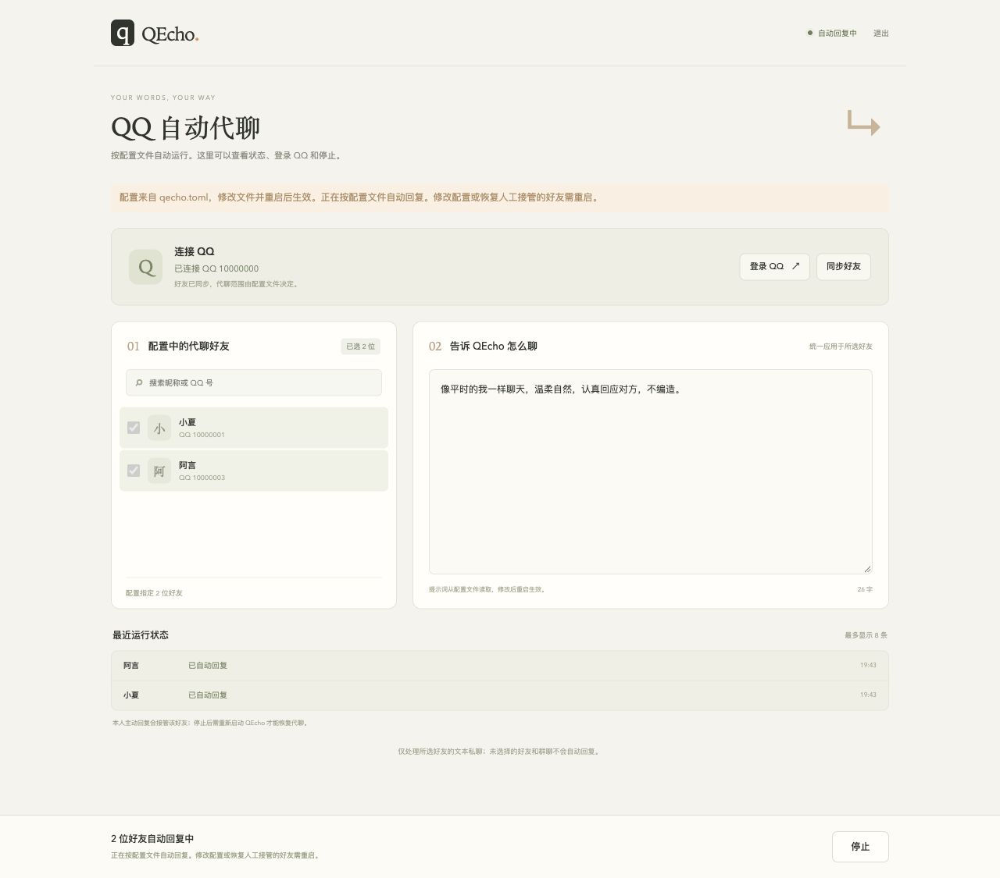

# QEcho · 回声

**填好一份配置文件，启动 QQ 和 QEcho，按你的规则自动回复。**

QEcho 是一个本地运行的 QQ 代聊 Agent。你决定回复哪些好友，并用提示词控制人格、语气和聊天规则。推荐在 `qecho.toml` 集中填写模型、QQ 连接、好友范围和提示词，之后用启动脚本运行，无需在网页逐项填写。网页用于查看状态、打开 QQ 登录页和停止代聊；未使用配置文件时仍可通过网页配置。



截图使用本地模拟登录、模型与桥接验收，不是真实 QQ 对话。

部署顺序：[准备配置文件](#本地部署) → [安装并连接 NapCat](#napcat-部署与连接) → [一键启动](#3-一键启动)。

## 本地部署

采用 Python 3.12 + uv 源码运行。Windows / Linux 的依赖安装和自动化测试已通过 CI，macOS 已完成本地验收，具体范围见[验证记录](docs/validation.md)。QQ 登录由外置 NapCat 提供，按其支持的平台安装；一个 QEcho 数据目录对应一个 QQ 账号。

### 1. 安装 Git 和 uv

安装 [Git](https://git-scm.com/downloads)，再按 [uv 官方说明](https://docs.astral.sh/uv/getting-started/installation/)安装 uv。

Windows PowerShell：

```powershell
winget install --id=astral-sh.uv -e
```

macOS / Linux：

```sh
curl -LsSf https://astral.sh/uv/install.sh | sh
```

重新打开终端，确认 `git --version` 和 `uv --version` 可用。Python 由下一步的 uv 命令管理，前端无需 Node.js 构建。

### 2. 下载项目并填写配置

```sh
git clone https://github.com/xuhuilun/QEcho.git
cd QEcho
```

复制仓库中的 [`qecho.example.toml`](qecho.example.toml) 为同目录的 **`qecho.toml`**。Windows PowerShell：

```powershell
Copy-Item qecho.example.toml qecho.toml
```

macOS / Linux：

```sh
cp qecho.example.toml qecho.toml
chmod 600 qecho.toml
```

用文本编辑器打开 `qecho.toml`，按样例中的注释填写。关键字段如下，其余保留默认即可：

```toml
[model]
mode = "live"
base_url = "https://你的模型服务地址/v1"
name = "服务商提供的模型名称"
api_key = "你的模型 API Key"

[qq]
api_url = "http://127.0.0.1:3000"
api_token = "与 NapCat HTTP 服务端相同的 token"
login_url = "http://127.0.0.1:6099/webui/qq_login"
event_token = "自行生成的至少16位ASCII随机字符串"

[agent]
friends = ["12345678", "87654321"]
prompt = """
像平时的我一样聊天，语气温柔自然，回复简短。
认真回应对方提到的事情，不要连续追问。
不知道我的经历或安排时不要编造，也不要替我作出承诺。
"""
auto_start = true
```

上面是需要修改的字段示意，不能直接使用占位地址、名称、密钥或 QQ 号。`base_url` 填聊天补全 API 根地址，程序会追加 `/chat/completions`。好友 QQ 号要加英文引号；多行提示词用开头、结尾各三个英文双引号包住。样例默认 `auto_start = false`，准备好后改为 `true` 才会自动启动。

真实配置文件已被 Git 和 Docker 构建上下文忽略，仍需自行保管其中的密钥。完整字段和校验说明见[配置文件使用说明](docs/file-configuration.md)。接着按下面的 [NapCat 部署与连接](#napcat-部署与连接)完成桥接安装、扫码和双向 HTTP 设置。

### 3. 一键启动

准备好配置和 NapCat 后，在项目根目录启动：

| 系统 | 启动方式 |
| --- | --- |
| Windows | 双击 `start.bat` |
| macOS | 双击 `start.command` |
| Linux | 终端执行 `./start.sh` |

脚本会先安装 Python 3.12，再按 `uv.lock` **下载并安装 Python 运行依赖**，最后读取 `qecho.toml` 启动。首次需要网络；后续复用已有环境和缓存。无需手动激活虚拟环境，也无需 Node.js。如果忘记创建配置，脚本只生成 `qecho.toml` 并退出，编辑后再次启动。

看到 `Application startup complete` 后保持终端运行。若 NapCat 未连接或 QQ 未登录，QEcho 在后台等待；登录后重新核对实际账号和好友名单，再开始回复。缺失好友或账号历史冲突会保持停止，需修正后重启。`auto_start = false` 时保持停止。

自动回复无需打开网页。需要查看状态或停止时，打开 <http://127.0.0.1:8765>，使用 `server.admin_token` 登录；该字段留空时，从 `.data/admin-token` 读取自动生成的令牌：

```powershell
# Windows PowerShell
Get-Content .data/admin-token
```

```sh
# macOS / Linux
cat .data/admin-token
```

文件模式下网页只显示已配置的名单与提示词，不能修改。**点击停止后，本轮运行不会自动恢复；关闭启动终端并重新启动才能恢复。** 修改文件同样需重启生效。按 `Ctrl+C` 结束服务；NapCat 需要保持运行。

需要检查配置或在终端直接启动时：

```sh
uv python install 3.12
uv sync --locked --no-dev
uv run --no-sync qecho --config qecho.toml --check-config
uv run --no-sync qecho --config qecho.toml
```

`uv run qecho` 会自动发现当前目录的 `qecho.toml`。不存在该文件且未指定 `--config` / `QECHO_CONFIG` 时，进入原有网页配置模式，操作见[部署说明](docs/deployment.md#网页配置模式)。

### 提示词分组

`[agent].prompt` 是所有好友共用的全局系统提示词。未分组的好友放在 `[agent].friends`，自定义组的好友直接放进该组的 `friends`。以下示例中，`12345678` 使用全局默认组，另外两位好友共用「亲近好友」提示词，`23456789` 还会应用个人提示词。

```toml
[agent]
friends = ["12345678"]
prompt = "自然回复，保持事实准确，不替我作承诺。"
auto_start = true

[[agent.prompt_groups]]
name = "亲近好友"
friends = ["23456789", "34567890"]
prompt = "语气轻松，主动回应对方提到的细节。"

[agent.friend_prompts]
"23456789" = "称呼对方为小林，少用表情。"
```

编辑已有文件时，在原 `[agent]` 中修改全局字段，在其后追加分组和个人提示词表。每位好友只列在一个组内。生成回复时依次加入全局、分组和个人提示词，称呼、语气等偏好优先采用更具体的设定。个人提示词只能附加给已列入代聊范围的好友。修改后重启，网页可查看分组和个人提示词标记。[配置字段与校验说明](docs/file-configuration.md#提示词分组与个人提示词)

## NapCat 部署与连接

QEcho 负责 AI 和代聊规则，NapCat 负责 QQ 登录与消息收发。**两者都需要启动并保持运行。** 以下步骤默认两者在同一台电脑上直接运行。

### 1. 安装并启动 NapCat

根据自己的系统完成对应步骤。以下入口已于 2026-11-10 核对；安装包名称和系统要求变化时，以链接中的官方说明为准。

#### Windows

推荐官方一键安装包，适用 Windows amd64（通常为 Intel/AMD 64 位电脑）：

1. 打开 [NapCatQQ 官方下载页](https://github.com/NapNeko/NapCatQQ/releases/latest)，在 **Assets** 中下载 `NapCat.Shell.Windows.OneKey.zip` 并解压。
2. 运行解压后的 `NapCatInstaller.exe`，按提示完成安装。此安装方式无需预先安装 QQ。
3. 进入生成的 `NapCat.XXXX.Shell` 目录，双击 **`napcat.bat`** 启动。
4. 保持 NapCat 运行，记录启动窗口给出的 WebUI 地址，继续下一节登录。

这里的文件名对应官方 **OneKey** 安装包。[官方 Windows 一键安装说明](https://napneko.github.io/guide/boot/Shell#windows-onekey)

#### macOS

使用官方 [NapCat-Mac-Installer](https://github.com/NapNeko/NapCat-Mac-Installer)，要求 macOS 12+，支持 Intel / Apple Silicon：

1. 先将 QQ 安装到 **`/Applications/QQ.app`**。
2. 从[安装器官方下载页](https://github.com/NapNeko/NapCat-Mac-Installer/releases/latest)下载并打开安装器，选择 NapCat 版本及下载方式后安装。
3. 按提示备份并授权修改 QQ 入口，选择 **“切换程序入口 NapCat”**，再启动。
4. 如果系统拒绝修改入口，在“系统设置 → 隐私与安全性 → App 管理”允许安装器管理 QQ；首次要求访问 QQ 数据目录时，按安装器提示授权。
5. 保持 NapCat / QQ 运行，从启动输出获取 WebUI 地址。

恢复原版入口时，在安装器选择“切换程序入口 原版 QQ”。更新时保留原配置和插件。[官方 macOS 安装说明](https://napneko.github.io/guide/boot/Shell#macos)

#### Linux

推荐官方安装脚本，适用使用 apt / dnf 的 amd64、arm64 系统。在准备运行 NapCat 的用户终端中执行：

```sh
curl -fL --connect-timeout 20 --max-time 1800 \
  -o napcat.sh https://raw.githubusercontent.com/NapNeko/NapCat-Installer/main/script/install.sh &&
bash napcat.sh --docker n --cli y --github-proxy 0
```

该命令使用官方原生安装路线，默认安装到当前用户的 `~/Napcat`。完成后使用同一用户运行管理命令，按管理界面提示启动：

```sh
napcat
```

保持服务运行，查看启动日志中的 WebUI 地址。其他发行版、缺失系统依赖或下载问题按[官方 Linux 安装说明](https://napneko.github.io/guide/boot/Shell#linux)排查。

### 2. 打开 NapCat WebUI 并登录 QQ

1. 打开 NapCat 启动日志给出的 WebUI 地址，常见为 `http://127.0.0.1:6099/webui/`。
2. 使用 NapCat 日志中的 WebUI token / 密码进入管理页；需要时查看 NapCat 实际配置目录中的 `webui.json`。这是 **NapCat WebUI 登录凭据**。
3. 进入 QQ 登录页，选择扫码登录，用手机 QQ 扫码并确认，等待页面显示登录完成。如果页面要求重新认证或修改 WebUI 密码，按当前提示完成。
4. 确认实际登录的是准备交给 QEcho 代聊的 QQ。

WebUI 默认端口为 `6099`，被占用时可能自动递增，以启动日志为准。三个端口分别负责：

| 默认端口 | 用途 |
| --- | --- |
| `8765` | QEcho 页面、管理 API 和事件接收 |
| `6099` | NapCat WebUI，登录 QQ 与管理连接 |
| `3000` | 下面要创建的 NapCat OneBot HTTP 服务，供 QEcho 查询好友和发送消息 |

登录页地址与 WebUI 凭据行为见 [NapCat 官方配置说明](https://napneko.github.io/config/basic)。

### 3. 在 NapCat 创建 HTTP 服务端

在 NapCat WebUI 的网络配置中“新建”一个 **HTTP 服务端**，填写并保存启用：

| 字段 | 填写内容 |
| --- | --- |
| 名称 | `qecho-api` |
| 启用 / 保存时启用 | 开启 |
| Host / 监听地址 | `127.0.0.1` |
| Port / 端口 | `3000` |
| 消息格式 | `array`（数组） |
| Token / 访问令牌 | 自己生成的一段随机字符串，下一步原样填入 QEcho |

可以在 QEcho 项目目录执行以下命令生成随机字符串，然后保存到两边的对应字段：

```sh
uv run --no-sync python -c "import secrets; print(secrets.token_urlsafe(32))"
```

该 HTTP 服务用于 **QEcho → NapCat** 的查询与发送调用。

### 4. 把 NapCat 服务地址填入 QEcho

编辑 `qecho.toml` 的 `[qq]`，与刚创建的 HTTP 服务端保持一致：

| 配置字段 | 填写内容 |
| --- | --- |
| `qq.api_url` | `http://127.0.0.1:3000` |
| `qq.api_token` | 上一步 HTTP 服务端设置的 token |
| `qq.login_url` | `http://127.0.0.1:6099/webui/qq_login`，端口按实际 WebUI 地址修改 |

本人 QQ 号由同步自动识别，无需手填。文件修改后重启 QEcho 生效。未使用配置文件时，对应参数可在网页“连接设置 → QQ 连接设置”中保存。

### 5. 在 NapCat 创建 HTTP 客户端

将 `qecho.toml` 的 `qq.event_token` 设置为至少 16 位 ASCII 随机字符串。返回 NapCat 网络配置，新建一个 **HTTP 客户端**，填写并保存启用：

| 字段 | 填写内容 |
| --- | --- |
| 名称 | `qecho-events` |
| 启用 / 保存时启用 | 开启 |
| URL / 上报地址 | 默认 `http://127.0.0.1:8765/webhooks/onebot`，端口与 `server.port` 一致 |
| 消息格式 | `array`（数组） |
| `reportSelfMessage` / 上报自身消息 | 开启，用于识别本人回复并接管 |
| Token | 与 `qq.event_token` 完全相同的值 |

该连接用于 **NapCat → QEcho** 推送好友消息。NapCat 会使用事件令牌对上报正文签名，QEcho 验证后接收。`qq.event_token` 留空时，先启动 QEcho，再读取数据目录中的 `webhook-token` 填到 NapCat；不要把空字符串当成事件令牌。网页模式可在“QQ 连接设置”复制令牌和上报地址。完整字段依据见 [NapCat 官方网络配置](https://napneko.github.io/config/basic)。

四种令牌用途如下：

| 名称 | 从哪里取得 | 填到哪里 |
| --- | --- | --- |
| QEcho 管理令牌 | `server.admin_token`；留空则读取 `.data/admin-token` | QEcho 首次进入页面的登录框 |
| NapCat WebUI token / 密码 | NapCat 启动日志或实际配置目录 | NapCat WebUI 登录页 |
| NapCat HTTP 服务端 token | 上述第 3 步自己设置 | `qq.api_token` |
| QEcho 事件令牌 | `qq.event_token`；留空则读取 `.data/webhook-token` | NapCat HTTP 客户端的 token |

### 6. 检查连接是否成功

1. 保持 QEcho 和 NapCat 都在运行，在 QEcho 点击“同步好友”。出现正确的 QQ 号与好友列表，说明查询方向正常。
2. 在配置文件指定一位测试好友，填写提示词，确认真实模型参数有效并设置 `auto_start = true`，重启 QEcho；观察页面显示“自动回复中”。
3. 让这位好友发来文本私聊，检查“最近运行状态”和 QQ 实际收到的回复，确认事件上报与发送都正常。
4. 点击“停止”，再确认后续来信不自动回复。通过后按需增加好友。

常见连接问题：

| 现象 | 排查 |
| --- | --- |
| NapCat 登录页打不开 | 先启动 NapCat；按其日志确认 WebUI 实际端口，更新 QEcho 登录页地址 |
| 已登录 QQ，但同步好友失败 | 检查 HTTP 服务端是否已启用、3000 端口和服务端 token 是否一致 |
| 好友能同步，但没有回复 | 检查 HTTP 客户端已启用、上报 URL 和事件令牌正确，并确认自动启动开关、默认组或自定义组名单以及页面运行状态 |
| 401 / 签名校验失败 | 按上面的令牌表核对两边对应值；修改事件令牌后同步更新 NapCat HTTP 客户端 |
| 本人回复后 Agent 仍在回复 | 检查 `reportSelfMessage` 已开启且桥接实际报告本人消息；仍可在 QEcho 点击“停止” |

以上地址只适用于同一电脑、同一网络环境。跨电脑、虚拟机或容器时，`127.0.0.1` 指各自环境自身，应改成双方可达的地址并保留认证、限制访问范围，详见 [QQ 接入说明](docs/qq-connection.md)。安装说明和字段已按官方资料核对，真实账号登录与收发仍需在使用者环境完成验收。

## 开始代聊

文件模式在默认组或自定义组填写好友 QQ 号，设置全局提示词和 `agent.auto_start = true`，再运行启动脚本。登录 QQ 后程序自动核对名单并开始。网页展示当前账号、名单与分组、全局提示词和最近状态。修改配置或恢复被停止、人工接管的代聊，需要重新启动 QEcho。

未使用 `qecho.toml` 时，保留以下网页流程：

1. 点击 **登录 QQ**，打开 NapCat 登录页。页面可能先要求 NapCat WebUI 认证，再选择扫码登录，并在手机确认。
2. 返回 QEcho，登录成功后自动读取 QQ 账号和好友；必要时点击 **同步好友**。无需手填本人 QQ 号。
3. 搜索并勾选需要代聊的好友，在右侧写一份统一 Agent 提示词，例如：

```text
像平时的我一样聊天，语气温柔自然，回复简短。
认真回应对方提到的事情，不要连续追问。
可以聊音乐、电影和日常，不知道我的经历或安排时不要编造。
```

4. 点击 **保存并开始自动回复**。只对选中好友的文本私聊自动回复，未选择的好友和群聊不参与。页面显示运行状态与最多 8 条最近回复状态。

修改选择或提示词后，需再次点击“保存并开始自动回复”一起生效；未应用的修改会有提示。需要立即暂停时，点击始终可用的 **停止**。本人主动回复可接管单个好友，再次明确开始可恢复所选好友。

开始时会重新核对实际 QQ 账号、好友范围和配置版本，失败保持停止。已有真实聊天历史时检测到换号，会暂停并要求新账号使用独立数据目录。已开始的发送请求可能仍会送达，停止不等于撤回；发送结果未知时系统不自动重试。

## 更换端口、备份与升级

文件模式直接修改 `qecho.toml` 的 `server.port` 后重启。例如改用 8766 端口，浏览器和 NapCat 上报 URL 都同步改成 8766。相对 `server.data_dir` 以配置文件所在目录为基准；修改管理/事件令牌后，网页和 NapCat 对应凭据也需更新。未使用文件时可按[部署文档](docs/deployment.md)使用环境变量。

升级前在页面停止自动回复，再在运行终端按 `Ctrl+C` 停止服务，将 `qecho.toml` 和整个数据目录（默认 `.data/`）复制到仓库外的新备份目录。随后更新代码并重新运行启动脚本，脚本会安装锁定依赖；终端方式也可：

```sh
git pull --ff-only
uv sync --locked
uv run qecho
```

`uv run qecho` 自动读取当前目录 `qecho.toml`。配置文件和数据目录含密钥，数据目录还含聊天记录，备份需妥善保管。数据库未做静态加密；POSIX 文件模式限制和 Windows 继承的 ACL 行为见[部署与数据管理](docs/deployment.md)。

## 常见问题

| 现象 | 检查方式 |
| --- | --- |
| `uv` 命令不存在 | 安装后重新打开终端，按安装提示检查 PATH |
| 脚本第一次启动就退出 | 首次会生成 `qecho.toml`；编辑后再运行，确认 `auto_start` 已按需开启 |
| 配置文件报错 | 执行 `uv run qecho --check-config`；QQ 号使用字符串，字段名按样例，不支持自定义字段 |
| Python / 依赖安装失败 | 检查网络后重试 `uv python install 3.12` / `uv sync --locked`，保留完整安装报错 |
| 页面打不开 | 保持服务终端运行，确认启动成功且端口正确 |
| 令牌文件不存在或无效 | 先启动服务，在项目目录读取；自定义数据目录或环境令牌时以实际配置为准 |
| 数据目录正在使用 | 停止同目录已有实例；同一个数据目录只允许一个进程 |
| 登录页打不开 | 先启动 NapCat，检查 `qq.login_url` 和实际 WebUI 端口 |
| 登录后没有好友 | 检查 OneBot HTTP 服务是否启用、地址/token 是否正确，然后同步好友 |
| 开始时报配置变化 | 其他操作或人工接管发生在启动期间；查看当前状态，再明确开始 |
| 好友来信不回复 | 检查运行开关、选中范围、真人接管状态以及最近错误；只支持好友文本私聊 |
| AI 请求失败 | 检查模型地址、名称、密钥和服务账户状态 |

## 文档与开发

- [极简流程设计](docs/simple-automation-design.md)
- [配置文件使用说明](docs/file-configuration.md)
- [集中配置设计](docs/file-config-design.md)
- [实施计划](docs/simple-automation-plan.md)
- [QQ 接入](docs/qq-connection.md)
- [部署与数据管理](docs/deployment.md)
- [API 说明](docs/api.md)
- [验证记录与限制](docs/validation.md)

```sh
uv run pytest
uv run ruff check .
uv run ruff format --check qecho tests
```

原有会话 API 和联系人数据保留兼容。文件模式使用文件中配置的全局、分组和好友个人提示词。真实模型人格效果、QQ 登录与真实好友收发仍需用户环境验收。

[Dockerfile](Dockerfile) 与 [compose.yaml](compose.yaml) 保留为可选配置，尚未实际验收容器运行。
